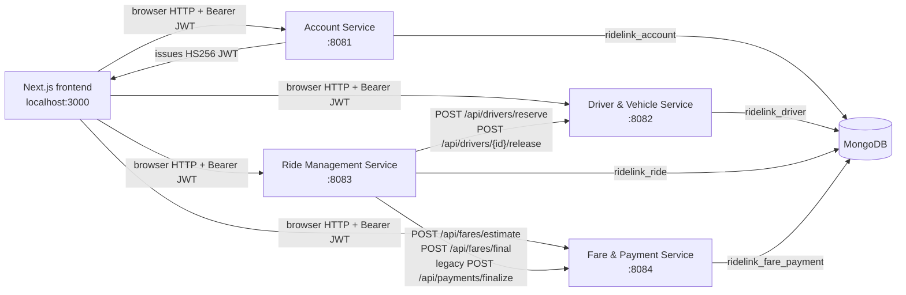

<div align="center">
<h1 align="center">🚕 RideLink</h1>
<p align="center">
  
</p>
<h3 align="center">Microservices behind a fictional ride-sharing platform — built, broken, and rebuilt until it actually worked.</h3>
 
<p align="center"><em>IT3130 — Application Development · SLIIT</em></p>
 
[](https://github.com/ImalkaDevHub/Ridelink/actions/workflows/ci.yml)


 
</div>
---
 
## 🧭 What is RideLink?
 
RideLink is a fictional ride-sharing platform — the plumbing behind a taxi-booking app, minus the taxis. No real drivers, no real payments, no real maps. What *is* real: four independent microservices, four independent databases, honest HTTP calls between them, and honest failure handling when one of them falls over.
 
A passenger requests a ride. A driver goes online and gets matched. A fare gets calculated. A payment gets simulated and recorded. Nobody's card is ever touched, and nobody's database is ever touched by a service that doesn't own it.
 
> 🎁 **Bonus round:** what started as a backend-only assignment grew a Next.js frontend, a Dockerized local stack, and a live cloud deployment (Render + Vercel + MongoDB Atlas) — none of which was required, all of which was too fun to leave out.
 
---
 
## 🏗️ Architecture
 
Four services. Four databases. Zero shared collections. All inter-service calls are HTTP requests; each service reads and writes only its own database.



The local Compose stack runs one MongoDB server with four separate databases. A failing dependency produces a structured error instead of cross-service database access.
 
---
 
## 🧩 The Services
 
| # | Service | Port | Owns |
|---|---------|:----:|------|
| 1 | 🔐 **Account Service** | `8081` | Registration, login, JWT issuance, roles, profile, account status |
| 2 | 🚗 **Driver & Vehicle Service** | `8082` | Driver profiles, vehicles, availability, eligible-driver lookup |
| 3 | 🧭 **Ride Management Service** | `8083` | Ride requests, driver assignment, ride lifecycle |
| 4 | 💳 **Fare & Payment Service** | `8084` | Fare estimates, final fare calc, simulated payments, receipts |
 
---
 
## ⚙️ Tech Stack
 
| Layer | Choice |
|---|---|
| **Language** | Java 21 |
| **Framework** | Spring Boot 4.1.1 |
| **Build tool** | Maven |
| **Database** | MongoDB — one database per service (`ridelink_account`, `ridelink_driver`, `ridelink_ride`, `ridelink_fare_payment`). Local via Docker Compose, cloud via MongoDB Atlas |
| **Interservice comms** | Synchronous REST over HTTP (`RestTemplate`) |
| **Auth** | JWT, issued by Account Service, validated by every protected endpoint via a shared signing secret |
| **API docs** | springdoc-openapi → live Swagger UI per service |
| **Containerization** | Docker (multi-stage builds) + Docker Compose for the whole stack |
| **CI** | GitHub Actions — matrix build across all 4 services on every push |
| **Frontend** *(bonus)* | Next.js — passenger & driver dashboards |
| **Cloud hosting** *(bonus)* | Render (backend services) · Vercel (frontend) · MongoDB Atlas (database) |
 
---
 
## 🚀 Getting Started
 
### Option A — Docker Compose (recommended, one command)
 
Builds and starts MongoDB, all four Spring Boot services, and the Next.js frontend. MongoDB data survives container restarts.
 
```bash
git clone https://github.com/ImalkaDevHub/Ridelink.git
cd Ridelink
cp .env.example .env
# Replace JWT_SECRET with a private random value of at least 32 characters.
# For example: openssl rand -base64 48
docker compose up -d --build
```
 
| Service | URL |
|---|---|
| Account Service | http://localhost:8081 |
| Driver & Vehicle Service | http://localhost:8082 |
| Ride Management Service | http://localhost:8083 |
| Fare & Payment Service | http://localhost:8084 |
| Frontend | http://localhost:3000 |
| MongoDB | `mongodb://localhost:27017` |
 
The four backend containers share `JWT_SECRET` and each use a separate database. Ride Service reaches Driver and Fare & Payment through Compose DNS; browser requests use `localhost` URLs. Stop everything with `docker compose down` (data persists in a named volume — add `-v` to wipe it). Never commit the populated root `.env`.
 
### Option B — Run each service manually
 
Start a MongoDB instance first (either `docker run -d -p 27017:27017 mongo:7`, or point at an Atlas cluster), then run each service **in this order** so interservice calls have something to talk to:
 
```bash
# 1. Account Service — auth for everything else
cd account-service/account-service
./mvnw spring-boot:run          # → http://localhost:8081
 
# 2. Driver & Vehicle Service — no dependencies
cd driver-service/driver-service
./mvnw spring-boot:run          # → http://localhost:8082
 
# 3. Ride Management Service — depends on Driver Service
cd ride-service/ride-service
./mvnw spring-boot:run          # → http://localhost:8083
 
# 4. Fare & Payment Service — depends on Ride Service
cd fare-payment-service/fare-payment-service
./mvnw spring-boot:run          # → http://localhost:8084
```
 
> 📁 Each service's Maven project lives one folder deeper than its top-level directory name (a leftover from the original Spring Initializr scaffold) — adjust the `cd` path if yours has been flattened since.
 
By default each service connects to its own local MongoDB database. Set `MONGODB_URI` to override a service's URI (for example, with an Atlas connection string), and use the same `JWT_SECRET` for all four backends. Ride Service supports `DRIVER_SERVICE_BASE_URL` and `FARE_SERVICE_BASE_URL`; local defaults point to ports 8082 and 8084.
 
### Frontend (optional)
 
```bash
cd frontend
npm install
npm run dev          # → http://localhost:3000
```
 
Create a `.env.local` pointing at whichever backend you're running:
 
```bash
NEXT_PUBLIC_ACCOUNT_API_URL=http://localhost:8081
NEXT_PUBLIC_DRIVER_API_URL=http://localhost:8082
NEXT_PUBLIC_RIDE_API_URL=http://localhost:8083
NEXT_PUBLIC_FARE_API_URL=http://localhost:8084
```

### Running the project with scripts

Bash scripts in `scripts/` run the four services and the frontend locally, without Docker. They work in Git Bash on Windows, Linux and macOS. Start MongoDB first, for example with `docker compose up -d mongo`. Local Java defaults use localhost; Compose DNS URLs are only set inside containers.

```bash
./scripts/start-all.sh            # start everything in dependency order, waiting for each port
./scripts/health-check.sh         # one-shot UP/DOWN table (exit 1 if anything is down)
./scripts/health-check.sh --watch # live dashboard, alerts on UP/DOWN changes (--interval N)
./scripts/stop-all.sh             # stop all five components and free their ports
```

Output from each component goes to `logs/<service>.log`. Ports, folders and start order are set in `scripts/config.sh`.

### 📚 Swagger UI
 
Once a service is running, its live API docs are at:
 
```
http://localhost:<port>/swagger-ui/index.html
```
 
---
 
## ☁️ Live Deployment (bonus, not graded)
 
The full stack is also deployed and reachable online — Render for the four Spring Boot services, Vercel for the frontend, MongoDB Atlas for the database.
 
| Component | Hosted on |
|---|---|
| Backend services (×4) | Render (Docker) |
| Frontend | Vercel |
| Database | MongoDB Atlas |
 
> ⏳ Render's free tier sleeps a service after 15 minutes of inactivity — the first request after a while can take 30–50 seconds to wake it back up. Perfectly normal, not a bug.
 
---
 
## 🔐 Authentication and roles

Registration (`POST /api/auth/register`) creates a `PASSENGER` by default; a self-registered account may instead choose `DRIVER`. Administrators cannot self-register. Login (`POST /api/auth/login`) returns the same token form. The Account Service signs an HS256 JWT containing the account ID, email, and role. Send it as `Authorization: Bearer <token>` to protected endpoints. All four services validate the signature with the same `JWT_SECRET`; they do not call Account Service for every request.

The Account Service seeds an administrator at startup when enabled. Configure its email and password with `ADMIN_EMAIL` and `ADMIN_PASSWORD`; never use development defaults outside a private local environment.

| Capability | `PASSENGER` | `DRIVER` | `ADMIN` |
|---|---|---|---|
| Register / log in | Yes | Yes | No self-registration |
| Manage own account profile/password | Yes | Yes | Yes (own password remains owner-only) |
| View/update account status or roles; list accounts | No | No | Yes |
| Create and manage own driver profile | No | Yes | Yes |
| View all drivers | No | No | Yes |
| Request rides / pay | Yes | No | No |
| Accept/start assigned rides | No | Yes | No |
| Cancel participant rides | Own passenger rides | Assigned rides | Any ride |
| Complete assigned rides | No | Yes | Yes |
| Finalize fares | No | Yes | Yes |
| View payments | Authenticated (receipt only payer/admin) | Authenticated | Yes |

### Ride lifecycle (sequence)

```mermaid
sequenceDiagram
    autonumber
    actor P as Passenger browser
    actor D as Driver browser
    participant R as Ride Service
    participant V as Driver Service
    participant F as Fare & Payment Service

    P->>R: POST /api/rides (Bearer passenger JWT)
    R->>V: POST /api/drivers/reserve (forward JWT)
    V-->>R: Reserved driver
    R->>F: POST /api/fares/estimate (forward JWT)
    F-->>R: Estimated fare (best effort)
    R-->>P: 201 ride ASSIGNED
    D->>R: PATCH /api/rides/{id}/accept
    R-->>D: Ride ACCEPTED
    D->>R: PATCH /api/rides/{id}/start
    R-->>D: Ride IN_PROGRESS
    D->>R: PATCH /api/rides/{id}/complete (distance and duration)
    R->>F: POST /api/fares/final (forward driver JWT)
    F-->>R: Idempotent final fare
    alt Legacy auto-charge enabled (default)
        R->>F: POST /api/payments/finalize
        F-->>R: Simulated legacy payment recorded
    else Passenger-pay mode (auto-charge disabled)
        R-->>D: Ride completed; passenger can pay separately
    end
    R->>V: POST /api/drivers/{id}/release
    R-->>D: Ride COMPLETED with final fare
    opt Passenger-pay mode
        P->>F: POST /api/payments
        F-->>P: Payment result; failed card attempts can be retried
        P->>F: GET /api/payments/{id}/receipt
        F-->>P: Receipt
    end
```

When the compatibility flag `ride.payment.auto-charge-on-complete` is enabled (default), completing a ride also records a legacy simulated payment; the passenger must not submit another payment for that ride. Set it to `false` to use the passenger payment endpoint as a separate step.

## 📡 API Overview
 
### 🔐 Account Service — `:8081`

| Method | Endpoint | Access | Description |
|--------|----------|--------|-------------|
| `POST` | `/api/auth/register` | Public | Register `PASSENGER` (default) or `DRIVER`; returns a JWT. `ADMIN` cannot self-register. |
| `POST` | `/api/auth/login` | Public | Verify credentials and return a JWT; suspended accounts are refused. |
| `GET` | `/api/auth/me` | Authenticated | Return the caller's own profile. |
| `GET` | `/api/accounts?page=0&size=20` | `ADMIN` | List accounts in pages; size is capped at 100. |
| `GET` | `/api/accounts/{id}` | Owner or `ADMIN` | Get profile; password is never returned. |
| `PATCH` | `/api/accounts/{id}` | Owner or `ADMIN` | Update profile name/email. |
| `PATCH` | `/api/accounts/{id}/password` | Owner only | Change password after verifying the current password. |
| `PATCH` | `/api/accounts/{id}/status?status=ACTIVE` | `ADMIN` | Activate or suspend an account. |
| `PATCH` | `/api/accounts/{id}/role?role=DRIVER` | `ADMIN` | Assign `PASSENGER`, `DRIVER`, or `ADMIN`. |
 
### 🚗 Driver & Vehicle Service — `:8082`

| Method | Endpoint | Access | Description |
|--------|----------|--------|-------------|
| `POST` | `/api/drivers` | `DRIVER` or `ADMIN` | Create a driver profile; account ID comes from the JWT. |
| `GET` | `/api/drivers` | `ADMIN` | List every driver. |
| `GET` | `/api/drivers/available?type=SEDAN` | Authenticated | List available drivers, optionally filtered by vehicle type. |
| `GET` | `/api/drivers/me` | `DRIVER` | Get the caller's driver profile. |
| `PATCH` | `/api/drivers/{id}/availability?available=true` | Owning `DRIVER` or `ADMIN` | Go online/offline. |
| `GET` | `/api/drivers/eligible?area=Malabe&vehicleType=SEDAN` | Authenticated | Find available drivers matching optional area and vehicle type. |
| `POST` | `/api/drivers/reserve?area=Malabe&vehicleType=SEDAN` | Authenticated; Ride Service internal | Atomically reserve one matching available driver. |
| `GET` | `/api/drivers/{id}` | Authenticated | Get a driver profile. |
| `PATCH` | `/api/drivers/{id}` | Owning `DRIVER` or `ADMIN` | Partially update a driver profile. |
| `PATCH` | `/api/drivers/{id}/location` | Owning `DRIVER` or `ADMIN` | Update current latitude/longitude. |
| `PATCH` | `/api/drivers/{id}/service-area` | Owning `DRIVER` or `ADMIN` | Update service area. |
| `POST` | `/api/drivers/{id}/release` | Authenticated; Ride Service internal | Release a reserved driver after completion/cancellation. |
 
### 🧭 Ride Management Service — `:8083`

| Method | Endpoint | Access | Description |
|--------|----------|--------|-------------|
| `POST` | `/api/rides` | `PASSENGER` | Request a ride; passenger ID comes from the JWT; a driver is reserved and an estimate requested. |
| `GET` | `/api/rides/{id}` | Ride participant or `ADMIN` | Get ride details. |
| `GET` | `/api/rides?status=COMPLETED` | Authenticated | List caller's rides; optional `status`, `passengerId`, and `driverId` filters are access-checked. |
| `PATCH` | `/api/rides/{id}/accept` | Assigned `DRIVER` | Move `ASSIGNED` → `ACCEPTED`. |
| `PATCH` | `/api/rides/{id}/start` | Assigned `DRIVER` | Move `ACCEPTED` → `IN_PROGRESS`. |
| `PATCH` | `/api/rides/{id}/cancel` | Passenger, assigned driver, or `ADMIN` | Cancel before `IN_PROGRESS`; optional body `{ "reason": "..." }`; releases driver. |
| `PATCH` | `/api/rides/{id}/complete` | Assigned `DRIVER` or `ADMIN` | Finalize fare, optionally record legacy payment, complete ride, and release driver. Body includes `distanceKm` and `durationMin`. |
 
### 💳 Fare & Payment Service — `:8084`
 
| Method | Endpoint | Access | Description |
|--------|----------|--------|-------------|
| `POST` | `/api/fares/estimate` | Public | Estimate fare from distance, coordinates, or known place names. |
| `POST` | `/api/fares/final` | `DRIVER` or `ADMIN`; Ride Service internal | Persist final fare, idempotent by `rideId`. |
| `POST` | `/api/payments` | `PASSENGER` | Pay stored final fare; body contains `rideId`, `method` (`CARD` or `CASH`) and optional `cardLast4`. |
| `GET` | `/api/payments/{id}` | Authenticated | Get one payment by payment ID. |
| `GET` | `/api/payments/ride/{rideId}` | Authenticated | List payment attempts, including failures. |
| `GET` | `/api/payments/{id}/receipt` | Payer or `ADMIN` | Get receipt by payment ID; a ride ID is accepted for compatibility. |
| `POST` | `/api/payments/finalize` | `DRIVER` or `ADMIN`; legacy Ride Service call | Persist final fare and record a simulated legacy payment as already collected. |
| `GET` | `/api/payments/{rideId}/status` | Authenticated | Return the paid payment or latest attempt. |

#### Fare rule

All amounts are in **LKR**, calculated with `BigDecimal` and stored as MongoDB `Decimal128`:

```
fare = max(minimumFare, baseFare + perKm × distanceKm + perMin × durationMin) × multiplier[vehicleType]
```

rounded to 2 decimal places (half-up). Defaults, all configurable in `fare-payment-service/.../application.properties` (`fare.*`):

| Setting | Default | Meaning |
|---|---:|---|
| `fare.base-fare` | 300 LKR | Base charge |
| `fare.per-km` | 120 LKR | Charge per kilometre |
| `fare.per-min` | 10 LKR | Charge per minute |
| `fare.minimum-fare` | 500 LKR | Minimum before vehicle multiplier |
| `fare.average-speed-kmh` | 25 km/h | Used to estimate duration if absent |

| Vehicle type | Multiplier |
|---|---:|
| `SEDAN` | 1.0 |
| `HATCHBACK` | 0.9 |
| `VAN` | 1.5 |
| `TUK` | 0.8 |
| `CAR` / `BIKE` (compatibility) | 1.0 / 0.6 |

Example: a 5 km, 12 min sedan ride is `max(500, 300 + 600 + 120) × 1.0 = 1020.00 LKR`; the same trip by van is `1530.00 LKR`.

For an **estimate**, the distance comes from `distanceKm` if given, else from pickup/destination coordinates (Haversine, straight-line), else from a small built-in table of place names (SLIIT, Malabe Junction, Colombo Fort, Kaduwela, Kandy, …). Without `durationMin`, the duration is estimated at `fare.average-speed-kmh` (25 km/h).

**Payments** always charge the stored final fare — the client never sends an amount. Paying before the fare is finalized returns `409 FARE_NOT_FINALIZED`; a card ending in `0000` is a simulated decline (`402 PAYMENT_FAILED`, the attempt is saved as `FAILED` and can be retried); a second payment for a paid ride returns `409 PAYMENT_ALREADY_EXISTS`.

### Error codes

Errors use JSON with `code` and `message` fields; validation errors may also include `details`.

| HTTP | Code | Meaning |
|---:|---|---|
| 400 | `VALIDATION_ERROR` | Request field/value failed validation. |
| 400 | `MALFORMED_JSON` | Request body is missing or invalid JSON. |
| 400 | `MISSING_PARAMETER` | Required query parameter was omitted. |
| 400 | `INVALID_ROLE` / `INVALID_STATUS` | Requested account role or status is unsupported. |
| 400 | `WRONG_PASSWORD` / `SAME_PASSWORD` | Current password did not match or new password is unchanged. |
| 400 | `DISTANCE_UNRESOLVED` | Fare estimate could not resolve distance from the supplied inputs. |
| 401 | `UNAUTHORIZED` | Missing, invalid, expired, or incorrectly signed JWT. |
| 401 | `INVALID_CREDENTIALS` | Login email/password combination is invalid. |
| 403 | `FORBIDDEN` | Caller lacks permission or is not an allowed ride/payment participant. |
| 403 | `ACCOUNT_SUSPENDED` | Suspended account cannot log in. |
| 404 | `ACCOUNT_NOT_FOUND` / `DRIVER_NOT_FOUND` / `RIDE_NOT_FOUND` | Requested account, driver, or ride does not exist. |
| 404 | `PAYMENT_NOT_FOUND` | No matching payment/receipt exists. |
| 409 | `EMAIL_ALREADY_EXISTS` | Account or driver email is already registered. |
| 409 | `VEHICLE_ALREADY_EXISTS` | Vehicle number is already registered. |
| 409 | `CONCURRENT_UPDATE` | Driver changed concurrently; retry after refreshing. |
| 409 | `NO_DRIVER_AVAILABLE` | No eligible driver can be reserved. |
| 409 | `INVALID_STATUS_TRANSITION` | Ride cannot make the requested lifecycle transition. |
| 409 | `FARE_NOT_FINALIZED` | Payment requested before a final fare was stored. |
| 409 | `PAYMENT_ALREADY_EXISTS` | Ride already has a successful passenger payment. |
| 409 | `DUPLICATE_PAYMENT` | Legacy completion attempted to create a duplicate payment. |
| 402 | `PAYMENT_FAILED` | Simulated payment declined; failed attempt is retained for retry. |
| 503 | `DRIVER_SERVICE_UNAVAILABLE` | Ride Service could not reach Driver Service to reserve a driver. |
| 503 | `FARE_SERVICE_UNAVAILABLE` | Fare Service was unavailable when finalizing the fare. |
| 503 | `PAYMENT_FAILED` | Fare Service was unavailable during legacy payment finalization. |
| 502 | `FARE_REJECTED` | Fare Service rejected the final-fare request. |
| 500 | `INTERNAL_ERROR` | Unexpected server error; response does not expose internals. |

Other unmapped HTTP errors keep their HTTP status and standard status-derived code.

### Service property examples

Each Maven service includes an `application-example.properties` alongside its active `application.properties`. The examples document local defaults and environment overrides for MongoDB, JWT, service-to-service URLs, admin seeding, and fare calculation:

- [Account Service example](account-service/account-service/src/main/resources/application-example.properties)
- [Driver Service example](driver-service/driver-service/src/main/resources/application-example.properties)
- [Ride Service example](ride-service/ride-service/src/main/resources/application-example.properties)
- [Fare & Payment Service example](fare-payment-service/fare-payment-service/src/main/resources/application-example.properties)

Docker Compose provides `MONGODB_URI`, `JWT_SECRET`, and Ride Service's backend base URLs at runtime; do not put secrets in these checked-in examples.
 
---
 
## 🧪 Testing the Full Flow
 
The end-to-end ride lifecycle, including both Ride Service dependencies, is shown in the [sequence diagram above](#ride-lifecycle-sequence). In brief:
 
```
1. Register/login passenger and driver; create a driver profile and set availability.
2. Passenger requests ride → Ride Service reserves a driver and requests a fare estimate.
3. Assigned driver accepts and starts the ride.
4. Driver completes ride → Ride Service requests final fare (and, by default, legacy auto-payment) from Fare & Payment Service.
5. With legacy auto-payment disabled, passenger pays the stored fare and retrieves the receipt.
```
 
...and the negative scenarios, all returning the same clean error shape:
 
```json
{ "code": "SOME_STABLE_ERROR_CODE", "message": "A human-readable explanation, no stack traces." }
```
 
| Scenario | Response |
|---|---|
| No available driver | `409` — `NO_DRIVER_AVAILABLE` |
| Driver Service unreachable | `503` — `DRIVER_SERVICE_UNAVAILABLE` |
| Invalid ride status transition | `409` — `INVALID_STATUS_TRANSITION` |
| Passenger tries to pay a ride that already has a successful payment | `409` — `PAYMENT_ALREADY_EXISTS` |
| Fare calculation unavailable during completion | `503` — `FARE_SERVICE_UNAVAILABLE` (ride status is not changed) |
| Legacy payment finalization unavailable during completion | `503` — `PAYMENT_FAILED` (ride status is not changed) |
 
---
 
## 🐳 Project Layout
 
```
Ridelink/
├── account-service/          # Account Service (auth, JWT, roles)
├── driver-service/           # Driver & Vehicle Service
├── ride-service/             # Ride Management Service
├── fare-payment-service/     # Fare & Payment Service
├── frontend/                 # Next.js dashboards (bonus)
├── docker-compose.yml        # Spins up MongoDB + all 4 services
└── .github/workflows/ci.yml  # CI: build + test all 4 services on every push
```
 
---
 
## 👥 Team
 
| Service | Owner |
|---------|-------|
| Account Service | *IT24102603 – Rajapaksha K.M.P* |
| Driver & Vehicle Service | *IT24102673 – Sathsarani R.D.S* |
| Ride Management Service | *IT24102531 - Nishshanka N.P.I.M* |
| Fare & Payment Service | *IT24102402 - Munasinghe M.S.D* |
 
---
 
## 📌 Notes
 
- A frontend, Docker deployment, and cloud hosting are all **optional enhancements** per the assignment brief and carry no separate marks — the four Spring Boot services, their tests, and their CI pipeline are what's actually assessed. Everything here is built regardless because we couldn't help ourselves.
- No real payments, maps, or third-party services are involved anywhere. Everything is simulated, on purpose.
- Each service maintains its **own** database — no table, collection, or connection is shared across services, by design.
<div align="center">
*Made with ☕, `docker compose up`, and a deadline that kept moving closer.*
 
</div>
 
